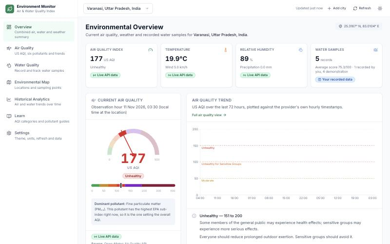
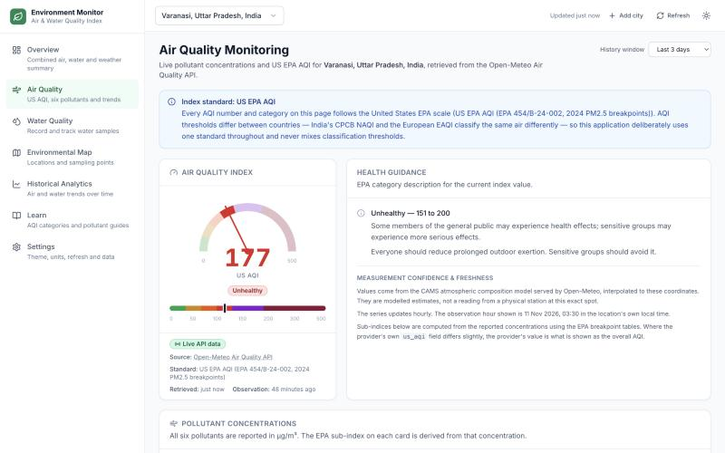
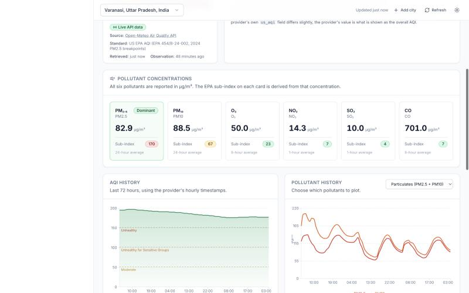
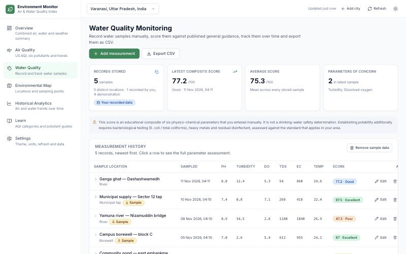
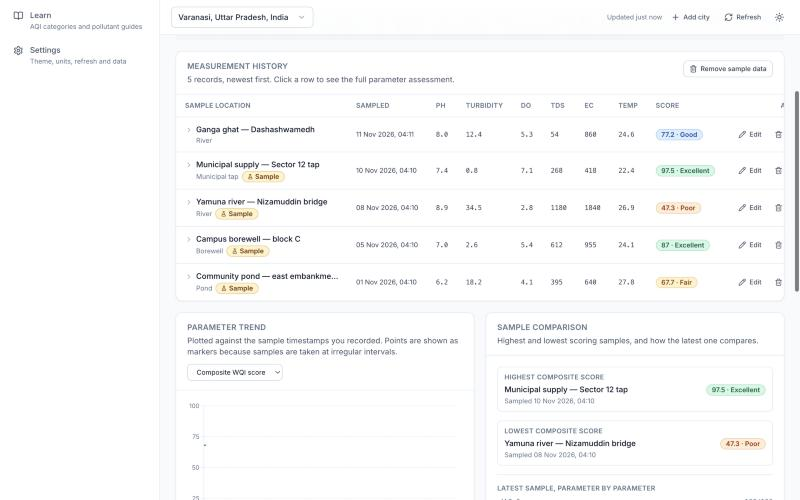
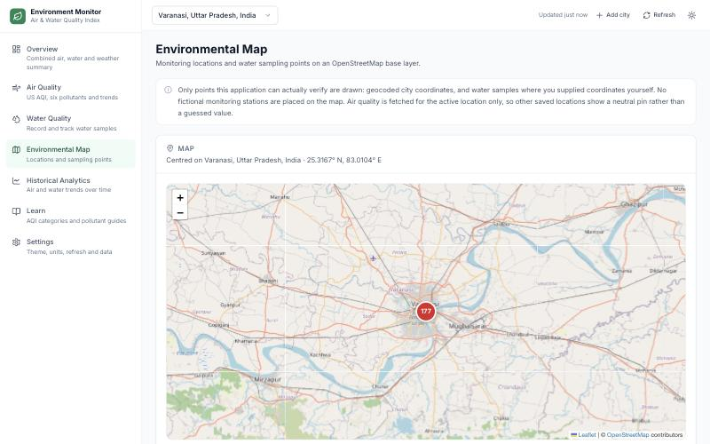
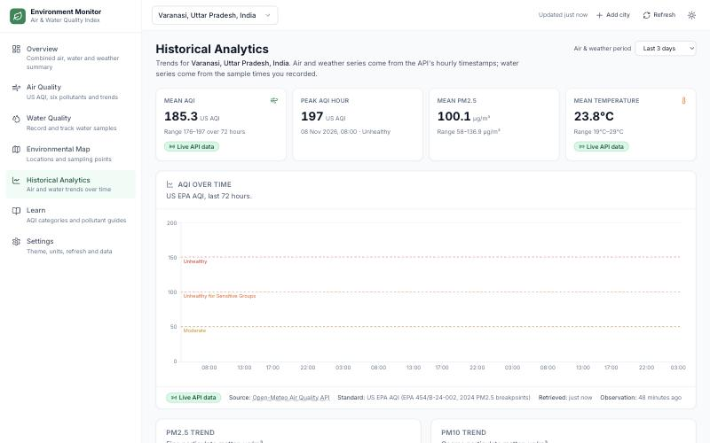
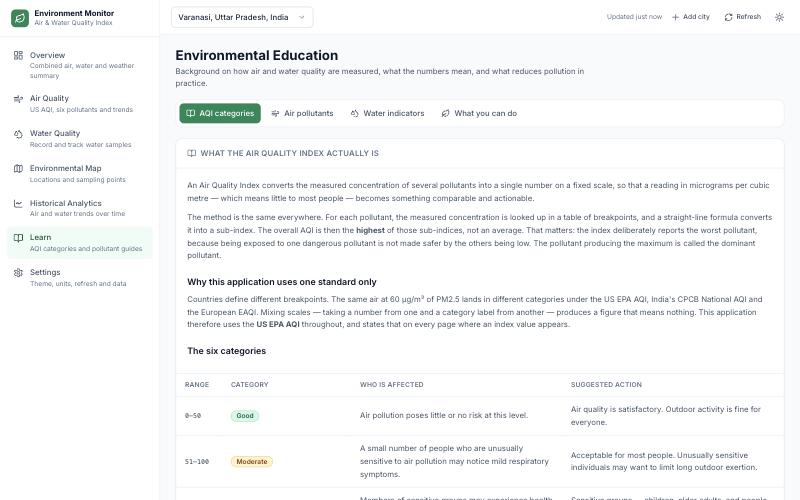
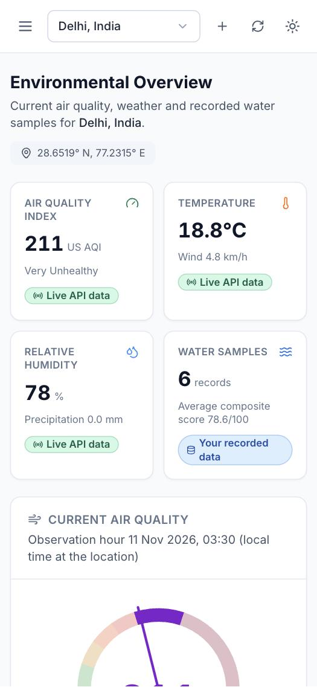
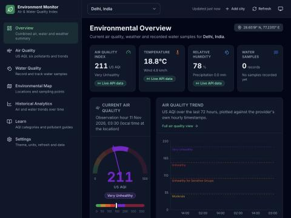

# Air and Water Quality Index and Environment Monitoring System

> **Problem statement (as issued):** Air and water quality index and environment monitoring
>
> **Project type:** Application Development — Major Project

A working environmental monitoring dashboard that brings live air quality data,
ambient weather conditions and manually recorded water quality measurements
together in one interface, and is explicit at every point about where each
number came from.

---

## Team

| Name | Role |
| --- | --- |
| Shambhavi | Project member |
| Rameez Rahman | Project member |
| Himanshu | Project member |

---

## Contents

- [What this project does](#what-this-project-does)
- [Screenshots](#screenshots)
- [Objectives](#objectives)
- [Features](#features)
- [Data integrity: the core design rule](#data-integrity-the-core-design-rule)
- [Technology stack](#technology-stack)
- [Getting started](#getting-started)
- [Available commands](#available-commands)
- [Data sources and APIs](#data-sources-and-apis)
- [How to use the application](#how-to-use-the-application)
- [Project structure](#project-structure)
- [Testing](#testing)
- [Known limitations](#known-limitations)
- [Future enhancements](#future-enhancements)
- [Further documentation](#further-documentation)

---

## What this project does

The application answers two questions for any location in the world:

1. **What is in the air right now, and how has it changed?**
   Live pollutant concentrations and the US EPA Air Quality Index are fetched from
   the Open-Meteo Air Quality API, charted over time, and explained.

2. **What is the state of the water we have sampled?**
   Because no free public API reports real-time pH, turbidity, dissolved oxygen,
   TDS, conductivity and temperature for an arbitrary water body, the application
   is a working field-record system: you record the measurements you actually
   took, and it stores, scores, charts, maps and exports them.

Everything on screen is labelled with its origin — **live API data**, **your
recorded data**, or **demonstration data** — so a reader can always tell which
is which.

---

## Screenshots

All screenshots below are from the running application with live API data.

### Overview dashboard


### Air quality monitoring


Pollutant concentrations, each with its EPA sub-index:



### Water quality monitoring


Measurement history, trends and sample comparison:



### Environmental map


### Historical analytics


### Environmental education


### Responsive and dark themes
| Mobile layout (375 px) | Dark theme |
| --- | --- |
|  |  |

---

## Objectives

1. Retrieve and display real air quality data for any searchable location, against
   a single, clearly stated index standard.
2. Compute and explain the US EPA AQI from pollutant concentrations, including the
   unit conversions and sub-index arithmetic, so the number can be verified by hand.
3. Provide a complete water quality record system — create, read, update, delete,
   persist and export — for measurements taken in the field or laboratory.
4. Score water samples against published general guidance using a documented,
   transparent index, while stating plainly what such a score cannot establish.
5. Visualise both air and water data over time using real timestamps.
6. Present monitoring locations and sampling points on an interactive map without
   inventing any monitoring station that does not exist.
7. Explain the underlying environmental science to a general audience.
8. Keep provenance visible everywhere, so live data, user data and demonstration
   data are never confused with each other.

---

## Features

### A — Environmental overview dashboard
Current AQI with category and dominant pollutant, temperature, humidity, wind and
precipitation, a 72-hour AQI trend, a water quality summary of the most recent
sample, plain-language environmental observations derived strictly from the values
on screen, and data-freshness indicators on every card.

### B — Air quality monitoring
- US EPA Air Quality Index on an arc gauge and a proportional 0–500 scale strip
- All six pollutants: PM2.5, PM10, O₃, NO₂, SO₂, CO
- EPA sub-index per pollutant, with the dominant pollutant highlighted
- Historical charts for AQI and for any pollutant group
- A **sub-index calculation table** showing the reported concentration, the
  converted value in the EPA's own unit, the averaging period and the resulting
  sub-index — so the arithmetic can be checked
- Full EPA category reference table with the current category highlighted
- Explicit statements of the index standard, measurement confidence and freshness

### C — Water quality monitoring
- Record pH, turbidity (NTU), dissolved oxygen (mg/L), TDS (mg/L), electrical
  conductivity (µS/cm) and water temperature (°C)
- Sample location, source type, date and time, optional coordinates, observations
- Full create / edit / delete with per-field validation and a two-step delete confirm
- Composite 0–100 water quality score with a documented weighting scheme and
  per-parameter sub-scores and messages
- Measurement history table with expandable per-sample assessment
- Trend chart for any parameter or for the composite score
- Sample comparison: highest and lowest scoring samples
- CSV export (RFC 4180 compliant, with a spreadsheet-injection guard)
- Local persistence; records survive a browser restart

### D — Interactive environmental map
Leaflet map on OpenStreetMap tiles. Round pins mark monitoring locations, coloured
by the AQI actually fetched for them; diamond pins mark water samples, coloured by
their composite score. Only verifiable points are drawn.

### E — Historical analytics
AQI over time, PM2.5 and PM10 trends, temperature and humidity, and water pH,
turbidity and dissolved oxygen trends. Minimum, maximum and mean are computed over
exactly the points plotted, with the hour count shown. The time period is
selectable from 24 hours to 7 days.

### F — Location search
Debounced, abortable city search over the Open-Meteo geocoding API, with saved
locations, a location switcher, and handling for short queries, no matches and
request failures.

### G — Environmental education
Four tabbed sections: AQI categories and how an index is actually built, the six
air pollutants and their sources and effects, water quality indicators and — stated
plainly — what they cannot tell you, and practical pollution reduction measures.

### H — Settings
Light / dark / system theme, temperature unit, auto-refresh interval, chart history
window, preferred location, local data management (export, load and reset
demonstration data, delete records, clear all local data), and a full data-source
and index-standard reference.

---

## Data integrity: the core design rule

This application never invents an environmental reading. Every dataset carries a
`DataProvenance` record describing its origin, and the interface renders that
provenance as a visible chip and footer.

| Origin | What it means | How it looks |
| --- | --- | --- |
| **Live API data** | Fetched from an external provider, with source name, retrieval time and observation time | Green chip |
| **Your recorded data** | Measurements you entered manually and the app stored locally | Blue chip |
| **Demonstration data** | Synthetic values generated locally by the app itself | Amber chip **and** a prominent banner |

Three rules follow from this, and the application keeps all three:

1. **Demonstration data is never a silent fallback.** If an API call fails, you get
   an error state with a retry button and an explicit *"Show demonstration data"*
   button. Synthetic values only ever appear because someone asked for them.
2. **Index standards are never mixed.** The application reports the **US EPA AQI**
   throughout. India's CPCB NAQI and the European EAQI use different breakpoints,
   so blending them would make the number meaningless. This is stated on the air
   quality page, in Settings and in the education section.
3. **Manual water measurements are never described as sensor data,** and the
   composite score is never described as a determination that water is safe to
   drink. That caveat appears wherever a score is shown.

---

## Technology stack

| Layer | Choice | Why |
| --- | --- | --- |
| UI library | React 18 | Component model, mature ecosystem |
| Language | TypeScript 5.7 (strict) | Catches unit and null errors at compile time |
| Build tool | Vite 7 | Fast dev server, small optimised production build |
| Styling | Tailwind CSS 3 | Consistent design tokens, class-based dark mode |
| Routing | React Router 7 | Client-side routing for the seven pages |
| Charts | Recharts 2 | Declarative, responsive, composes with React |
| Map | Leaflet 1.9 + React Leaflet 4 | Open-source mapping on OpenStreetMap tiles |
| Icons | Lucide React | Clean, consistent icon set |
| Persistence | Browser `localStorage` | No backend needed; data stays on the user's device |
| Testing | Vitest 4 + React Testing Library | Same transform pipeline as the app |

**No backend.** The application talks directly to public, key-less APIs and stores
user data locally. A server would add deployment complexity without enabling any
feature this project needs.

---

## Getting started

### Prerequisites

- **Node.js 20.19 or newer** (Node 22 LTS recommended) — <https://nodejs.org>
- npm 10+ (installed with Node.js)

Check what you have:

```bash
node --version && npm --version
```

### Install and run

```bash
npm install
```

```bash
npm run dev
```

Then open **<http://localhost:5173>** in a browser.

That is the whole setup. There is **no API key to obtain** and **no `.env` file to
create** — every data source the project uses is free and key-less. The
`.env.example` file exists only to document the optional API base-URL overrides.

### Build for production

```bash
npm run build
```

```bash
npm run preview
```

---

## Available commands

| Command | What it does |
| --- | --- |
| `npm run dev` | Start the Vite development server with hot reload on port 5173 |
| `npm run build` | Type-check the whole project, then build to `dist/` |
| `npm run preview` | Serve the production build locally to verify it |
| `npm run test` | Run the full test suite once |
| `npm run test:watch` | Run tests in watch mode while developing |
| `npm run typecheck` | Type-check without emitting output |

---

## Data sources and APIs

All four sources are free and require **no API key or registration**.

| Source | Used for | Documentation |
| --- | --- | --- |
| Open-Meteo Air Quality API | US EPA AQI and hourly PM2.5, PM10, CO, NO₂, SO₂, O₃ concentrations | <https://open-meteo.com/en/docs/air-quality-api> |
| Open-Meteo Weather Forecast API | Temperature, relative humidity, wind speed, precipitation | <https://open-meteo.com/en/docs> |
| Open-Meteo Geocoding API | City search (backed by the GeoNames database) | <https://open-meteo.com/en/docs/geocoding-api> |
| OpenStreetMap raster tiles | Base map layer | <https://www.openstreetmap.org/copyright> |

### About the air quality values

Open-Meteo serves the **CAMS** atmospheric composition forecast, interpolated to
the requested coordinates. These are **modelled estimates, not readings from a
physical monitoring station at that exact point.** The application says so on the
air quality page rather than implying station-grade precision.

### Index standard

**US EPA AQI**, following EPA 454/B-24-002, using the PM2.5 breakpoints revised in
May 2024. Gaseous pollutants are converted from µg/m³ to ppm or ppb using the
ideal-gas molar volume at 25 °C and 1 atm (24.45 L/mol) before the breakpoint
lookup, and values are truncated rather than rounded, as the EPA method requires.
The overall AQI is the **maximum** of the pollutant sub-indices, not an average.

---

## How to use the application

### Change location
Click the location name in the top bar to switch between saved locations, or click
**Add city** to search for any city worldwide. Selecting a city saves it and makes
it active.

### Record a water measurement
1. Go to **Water Quality** and click **Add measurement**.
2. Enter the sample location and, if you have them, coordinates — the
   *"Use current monitoring location coordinates"* button fills them from the
   active location.
3. Enter the six measured parameters. Each field shows its acceptable range and is
   validated against a plausible physical range.
4. Add any observations and save.

The record appears immediately in the history table, scored and charted, and is
persisted to your browser.

### See how the module works before you have data
Click **Load sample data** to add five clearly labelled demonstration samples.
They carry an amber "Sample" chip everywhere they appear, and
**Settings → Reset demonstration data** removes them without touching your own
records.

### Export records
**Export CSV** on the Water Quality page downloads every record with its computed
score, rating, parameters of concern and a **Data Origin** column, so the exported
file remains self-describing.

### Work offline
If a data provider is unreachable, each page shows an error state with **Try
again** and **Show demonstration data**. Water quality works fully offline, because
those records live in your browser.

---

## Project structure

```
environment-monitoring-system/
├── docs/                      Project documentation and screenshots
├── public/                    Static assets (favicon)
├── src/
│   ├── components/
│   │   ├── air/               AQI gauge, scale strip, pollutant cards
│   │   ├── charts/            Recharts wrappers and chart theming
│   │   ├── layout/            App shell, sidebar, top bar, nav definitions
│   │   ├── map/               Leaflet map (lazy-loaded)
│   │   ├── ui/                Shared primitives: cards, buttons, states, badges
│   │   ├── water/             Measurement form and history table
│   │   ├── ErrorBoundary.tsx  Catches render errors
│   │   ├── LocationSearch.tsx Debounced city search
│   │   └── StatCard.tsx       Metric tile and page header
│   ├── context/               Settings, locations, water records, environment data
│   ├── hooks/                 useEnvironmentData — fetching, refresh, abort
│   ├── lib/                   aqi, wqi, csv, storage, guards, format, id
│   ├── pages/                 One file per route
│   ├── services/              API clients, demo data generators, HTTP helper
│   ├── test/                  Test environment setup
│   └── types/                 Shared domain types
├── .env.example               Optional API base-URL overrides (not required)
├── index.html
├── package.json
├── tailwind.config.js
├── tsconfig*.json
├── vite.config.ts
└── vitest.config.ts
```

---

## Testing

```bash
npm run test
```

**181 tests across 11 files**, covering:

| Area | What is tested |
| --- | --- |
| `lib/aqi` | Every EPA breakpoint boundary, truncation rules, µg/m³ → ppm/ppb conversion for all four gases, maximum-not-average aggregation, scale capping, null handling |
| `lib/wqi` | Scoring curves, weight normalisation, composite scores verified by hand, rating bands, provenance summaries |
| `lib/csv` | RFC 4180 escaping, formula-injection guard, document structure, origin labelling, download lifecycle |
| `lib/storage` + `lib/guards` | Corrupt JSON, wrong-shape data, quota failures, every validator |
| `lib/format` | Relative time, unit conversion, null handling, location name de-duplication |
| `services/airQuality` | Request construction, forecast-hour trimming, local→UTC timestamp conversion, provider error propagation, missing-field handling |
| `services/geocoding` | Result mapping, short-query short-circuit, no-match vs error |
| `services/demoData` | Demo labelling, determinism, physical plausibility |
| `context/WaterContext` | Full CRUD lifecycle, sorting, persistence, restore after remount, corrupt-data recovery |
| `components/.../WaterMeasurementForm` | Validation, range checks, submission payload, edit prefill |
| `App` | Every navigation item renders its page, provenance labelling, API-failure recovery |

Verified results are recorded in [`docs/PROJECT_REPORT.md`](docs/PROJECT_REPORT.md).

---

## Known limitations

These are real constraints of the project, stated honestly.

1. **Air quality values are modelled, not measured at a station.** They come from a
   global atmospheric model interpolated to coordinates. Real air quality varies
   sharply over a few hundred metres.
2. **Water quality data is entirely manual.** There is no public real-time API for
   arbitrary water bodies, so the application cannot fetch water data at all.
3. **The water quality score is this project's own composite.** Its acceptable
   ranges draw on published general guidance (WHO drinking-water guidelines, the
   Indian standard IS 10500), but the weighting scheme is ours and the index is not
   a certified or regulatory one.
4. **The six water parameters cannot establish drinking-water safety.** That needs
   bacteriological testing, heavy metals and residual disinfectant, against the
   locally applicable standard. The application repeats this wherever a score appears.
5. **Data is stored per browser.** `localStorage` does not sync between devices or
   browsers, and clearing site data erases the records. CSV export is the backup path.
6. **Air quality is fetched only for the active location,** so other saved locations
   show a neutral pin on the map rather than a guessed value.
7. **Hourly values compared against 24-hour breakpoints** are an approximation. EPA
   particulate breakpoints assume a 24-hour average; the application charts hourly
   values, which is why the trend matters more than any single reading.
8. **No authentication or multi-user support.** The application is single-user by
   design, with no backend.
9. **Ozone above 0.200 ppm** falls outside the EPA 8-hour table; the application caps
   the sub-index and flags it as capped rather than extrapolating.

---

## Future enhancements

- Integrate a government monitoring network API (for example CPCB in India) as a
  second, clearly labelled source, with a user-selectable index standard
- Accept CSV import of laboratory results, so bulk measurements can be loaded
- Add bacteriological and heavy-metal fields to the water record
- Compare multiple locations side by side on one chart
- Export a formatted PDF report for a selected location and period
- Offline support via a service worker, caching the last successful response
- Browser notifications when AQI crosses a user-set threshold
- Optional backend so records can sync across devices and be shared by a team

---

## Further documentation

| Document | Contents |
| --- | --- |
| [`docs/PROJECT_REPORT.md`](docs/PROJECT_REPORT.md) | Full project report: abstract, literature background, requirements, design, implementation, testing methodology, verified results, conclusion |
| [`docs/ARCHITECTURE.md`](docs/ARCHITECTURE.md) | Component structure, data flow, API request lifecycle, persistence, chart implementation |
| [`docs/DEMO_GUIDE.md`](docs/DEMO_GUIDE.md) | Five-minute demonstration walkthrough and likely viva questions with answers |
| [`GITHUB_UPLOAD_GUIDE.md`](GITHUB_UPLOAD_GUIDE.md) | Beginner-friendly guide to running the project and uploading it to GitHub |

---

## Licence and attribution

Built as a college major project for educational purposes.

- Air quality, weather and geocoding data: [Open-Meteo](https://open-meteo.com/),
  free for non-commercial use
- Map tiles: © [OpenStreetMap](https://www.openstreetmap.org/copyright) contributors,
  under the Open Database Licence

This application is **not** a certified environmental monitoring instrument. Its
output should not be used for regulatory, clinical or drinking-water safety decisions.
